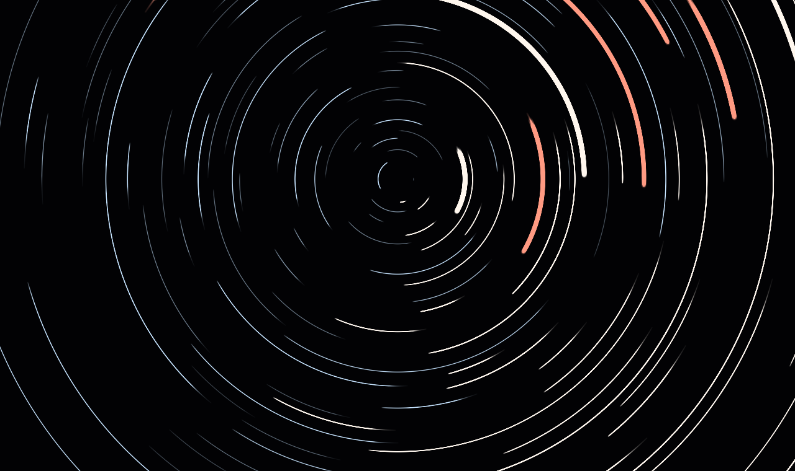
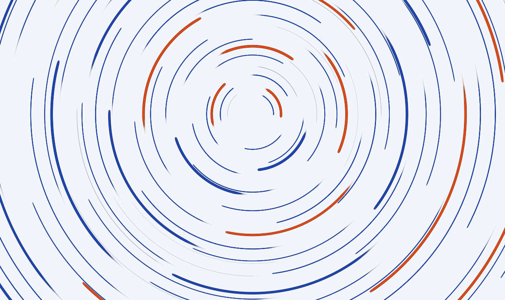

<div align="center">

# Escaping Notes

**STAR TRAILS · A Long Exposure of the Night Sky**

[**Live demo → escaping.top**](https://escaping.top)

[](https://github.com/Escap1ng/Escaping-Notes/releases)
[](https://github.com/Escap1ng/Escaping-Notes/actions/workflows/deploy.yml)
[](https://escaping.top)
[](https://vuejs.org/)
[](https://vite.dev/)
[](https://nodejs.org/)
[](#license--usage-terms)

[中文](README.md) · **English**

</div>

<table>
  <tr>
    <td width="50%"></td>
    <td width="50%"></td>
  </tr>
</table>

Left dark / right light. Neither is a screenshot: both are plates recomputed offline from the site's own constants (`npm run art:build`), drawing the trail layer only — recomputing the very steady-state plate a `prefers-reduced-motion` visitor sees. They were lifted by a ×2.8 / ×1.6 developing gain, so the live site is darker than they look. The dark plate then gets a hue-locking highlight compression: all three channels are scaled by a single ratio into range, so the cold blue and vermilion are not clipped channel-by-channel into cream.

A personal blog built as a long exposure of the night sky: the home screen is a camera left open, posts run by date, collections group by theme. Fully static, fixed at build time, publish on push.

**Stack**: Vue 3 · Vue Router 4 · Vite 5 · Canvas 2D. No backend, no third-party UI kit, no font CDN.

**Contents**

- [The camera keeps the exposure](#the-camera-keeps-the-exposure)
- [Interface](#interface)
- [Three load-bearing designs](#three-load-bearing-designs)
- [Quick start](#quick-start)
- [Adding things](#adding-things)
- [Route Map](#route-map)
- [Project Structure](#project-structure)
- [Deployment](#deployment)
- [Documentation](#documentation)
- [License & Usage Terms](#license--usage-terms)

---

## The camera keeps the exposure

Writing as a long exposure of the night sky: one camera set up on the home screen keeps the time for me. Three devices:

- **Scroll as time:** within the landing screen, the further down you go the longer the exposure window and the faster the sky turns (1 → 3.2×), saturating past 1.1 viewport heights
- **Pointer as time dilation:** trails within a 180px cursor radius locally accelerate and curl, fastest at the centre (up to 2.8×)
- **Meteors as narrative:** one falls every 6–9s, lives 900ms, at most 9 in frame; while the player is running the gap is squeezed to 40% of its range and relaxes back on its own

Trails are painted only inside the home screen's cell; the plate pixels and the site clock are singletons in `src/lib/sky.js` — changing routes never re-lays the plate, and returning home the arcs continue the previous exposure. Below the fold, photographs take over.

Flow curves, mask profiles and meteor parameters are recorded in [docs/design.md](docs/design.md) §3.

## Interface

**Visual**

- The landing screen carries only an English masthead: one line at 8.8vw on desktop (about 81% of the viewport), two lines at 15vw on phones; below the fold, chapters sit on cards
- Two themes, one mountain: the dark landing screen is a darkened bake of the same framing, both share a single ridge polyline; each theme deposits its own plate so colours never bleed
- The default is light and the first frame deliberately ignores the system `prefers-color-scheme`: the landing screen is a bright photograph, and following the system into dark would float a bright image on black
- Trails accumulate frame by frame in an offscreen buffer (Canvas 2D) and mask off along the ridge with `destination-in`: ~60% brightness kept near the crest, feathered over 26px
- Below the fold everything rides on one photographic plate shared site-wide: the "light plate III" as a single resident image, the dark theme on its own darkened bake — no scene change at night
- One token set builds every screen: 6 spacing steps, 11 type sizes, 4 line heights, 3 weights, 3 radii and 4 pointer-feedback tokens; one card token group; buttons in 2 sizes × 4 semantics. No raw font sizes or durations inside components — change a scale and the whole site follows
- Two self-hosted font families: the body serif Noto Serif SC is sharded by `unicode-range` and fetched on demand; the masthead Didone, Playfair Display, ships as a single file of uppercase and space. No font CDN

**Interaction**

- Plate blur and card surface are runtime parameters: a 0–12px slider (defaulted to full) and two radios (opaque / translucent) in the settings card, remembered in `localStorage`
- Focus traps live in the header drawer, the search card, the player card, the settings card and the article lightbox; closing returns focus to the trigger; `Esc` or a click outside the reading panel returns to the list; a bare `/` or `Ctrl/Cmd+K` anywhere opens search; route changes are announced through the live region in `App.vue`
- The player remembers track and position (the first play after a reload resumes), answers OS media keys, and states "cannot play" outright when the audio is missing — never stuck loading
- Skeleton cards while the archive loads, distinct copy for "nothing here yet" vs "no search results"; tag and keyword filters live in the URL query, so a filtered view is shareable and survives reload; the archive opens on a row of site-wide counters and every tag chip carries its own count

**Fallback and readability**

- `prefers-reduced-motion` gets a full static fallback: trails settle on the steady-state plate, transitions stay sharp, the vignette shuts off; touch targets reach 44px and the minimum type size is 11.5px
- Naked text on a scrim-free landscape photo cannot reach WCAG AA; the worst measured point is 1.0–1.8:1 regardless of gradient shape. So the plate stays scenery and body copy always lands on cards and reading panels. `npm run check:contrast` recomputes the theme tokens against a solid ground before every commit; it does not cover the composited photo
- The persistent header avoids `backdrop-filter`; glass is reserved for the reading panel (translucent mode) and the nav drawer. The article lightbox is flat, and the home chapter cards are persistent surfaces — neither builds this blur; the plate's own `--plate-blur` supplies the softness

## Three load-bearing designs

### The plate layer hangs on `App.vue` — one `fixed` containing-block trap


Below the fold the landscape is one `position: fixed` `.sub-plate` layer living in `App.vue`, shared by the home chapters and every secondary page. It has to hang there: `fall` puts a `filter` on the page root, and a filter becomes the containing block for `position: fixed` descendants — the same layer mounted inside `HomeView` measured as a `.home` box (587×1629, scrolling with the document), not a stationary backdrop at all. The drawer plate is a single resident image (the source list and the convergence rationale live in `site.css` §3). The measurements behind these decisions are recorded in the comments of `src/App.vue` and `src/lib/plate.js`.

### The `fall` afterimage — two pages on screen at once


Now that the plate persists across routes, `fall` is the only transition left: enter and leave run in parallel without `out-in`, and for the 380ms they overlap both pages are on screen, both blurred — that overlap is the afterimage. The plate must stay the same exposing pixels throughout: the star-trail camera now exists only on the home screen, still on screen and drawing every frame as it leaves, so the plate never freezes mid-frame. The `claimPlate()` hand-over lock in `sky.js` (deposition only, never redraw) remains as a guardrail; with a single camera it never fires.

The home page runs its own register: enter and leave are a plain opacity cross-dissolve (0.5s / 0.45s, 450ms overlap) with no scale, blur or colour shift. The home page is the tallest on the site — retiring the collapse feel also retires the per-frame re-rasterization of a full-page blur, the most expensive paint job here. Every other page keeps the fall in the diagram.

### The first-paint load order — the photo goes first, everything queues

The landscape photo on the landing screen is the home page's LCP. The inline first-paint script in `index.html` preloads it for the active theme, starting alongside the stylesheet; at ≤720px it takes an 1800px resample instead (1.45 → 0.09 MB light, 0.62 → 0.05 MB dark). The photo starts transparent over a 36px-wide, ~0.5 KB blurred stand-in (`--hero-lqip`, shipped with the stylesheet) and cross-fades in over 240ms once the gate opens.

The gate is `whenHeroReady()` in `src/lib/hero.js`: it reads the same URL from the `--hero-img` token and waits for one `load` — the image name is never copied a second time, and a stuck or failed image still releases instead of holding the page hostage. Everything else queues behind the photo:

- **Star trails**: the chunk prefetches while the photo downloads (the downlink is mostly idle then; a small chunk cannot steal its bandwidth), but mounting still waits for the gate — the loader then hits the module cache, saving one chunk round-trip
- **Section data**: `loadPosts()` below the fold runs after the gate; collections and projects are synchronous data and render as usual
- **Fonts**: on the mobile home page the display serif's CJK shard (~147 KB) also waits for the photo; until then headings use the system serif
- **The drawer plate** (mobile home, a 1280px resample) comes last: it only shows below the fold, so the beat when the photo lands gives the downlink to fonts and section data; the plate waits for the first scroll — no scroll, no download. A reload already past the fold, or leaving home for a secondary page, releases it immediately (there the plate is the body background)

So the order is **photo → trail mounting / section data / fonts, with the mobile drawer plate waiting for scroll**. The measurements behind it live in [docs/design.md](docs/design.md) §3 and the comments of `src/App.vue`.

## Quick start

Requirements: Node.js 22 or newer (`npm test` lets node expand the case list inside `tests/`, which needs 21 or newer; CI and the author's machine run 24).

```bash
git clone https://github.com/Escap1ng/Escaping-Notes.git
cd Escaping-Notes && npm install

npm run dev              # Vite dev server with HMR
npm run build            # post receipt + dist/ (rss.xml, sitemap.xml, one static shell per route)
npm run check            # the four gates in sequence (content / docs / naming / contrast) — run this before committing
npm test                 # everything under tests/, no test framework
```

CI in `.github/workflows/deploy.yml` runs `npm ci` → `npm test` → `npm run check` → `npm run build`, and only publishes to Pages when all of it is green.

### Scripts

| Command | Purpose |
| --- | --- |
| `npm run dev` | Vite dev server with HMR |
| `npm run build` | Posting gate and receipt first, then `dist/` (including `rss.xml`, `sitemap.xml` and one static shell per route) |
| `npm run preview` | Serve `dist/` the way production would |
| `npm test` | Everything under `tests/` (154 cases today), no test framework |
| `npm run check` | The four gates in sequence: content / docs / naming / contrast |
| `npm run seo:build` | Regenerate SEO artefacts only (`dist/rss.xml` — last 20 items, with full text and categories; `dist/sitemap.xml`) |
| `npm run og:build` | Redraw the share card `public/og.png` (1200×630, procedural star trails drawn with Node built-ins, no text, committed) |
| `npm run art:build` | Redraw the two plates at the top of the README (constants are read out of the source by regex and it throws if they are gone, so re-run after touching star-trail parameters) |
| `npm run bg:build` | Re-bake the site backdrops in `public/plates/*.jpg` (originals live in `plates-src/`, needs local PowerShell, commit the output) |
| `npm run cover:build` | Re-bake article covers: bakes each roll's own `*-src.jpg` into `cover.jpg` beside it in `content/posts/<slug>/` (no mapping table in the script; same requirements) |
| `npm run font:build` | Re-subset the body serif and split it into `unicode-range` shards (needs Noto Serif SC locally; the output is committed, so this is rarely needed — re-run when a new title uses a character outside the shipped shards) |
| `npm run font:build:didone` | Re-subset the masthead Didone (Playfair Display, uppercase and space only; the variable source TTF lives in `fonts-src/` and is not committed — fetch steps are in the script header) |
| `npm run check:content` | The posting gate and receipt: fails on a malformed date, a misspelled frontmatter key, or an image referenced from prose that is not in that roll (also runs inside `npm run build` and in CI) |
| `npm run check:docs` | Checks that every file path and section reference in the docs still resolves, and that the route table below matches `src/router` |
| `npm run check:naming` | Naming-convention scan; non-zero exit on a violation |
| `npm run check:contrast` | Recomputes WCAG contrast from the two theme blocks in `site.css`; non-zero exit if a text token fails |

What `npm test` guards is grouped by the filenames in `tests/`: the content layer (every posting rule probed with its own fake sample, a sweep proving both shores share one parser and that all site data passes through `src/data/index.js`, plus draft and alias rules), the release layer (per-page shell heads and placement, every URL advertised in the sitemap backed by a file, legacy `#/` links accepted or rejected, one routing mode only, drafts never shipping), rendering and the URL injection surface, parameters that must never drift (the blur defaults, the card-surface setting, the first-paint theme, the preloaded landing photo versus `site.css` in both themes and both width bands), the first-paint load order (photo → trail mounting / section data, trail chunk prefetched, mobile drawer plate waiting for scroll), the home transition exception (opacity-only keyframes, explicit reduced-motion coverage), the landing copy contract, pointer feedback and token single sourcing, the three project write-up fields, and both detail pages sharing one return mechanism.

## Adding things

There is no admin UI — everything is a file in this repo, and pushing publishes it:

- **A post is a directory.** `content/posts/<slug>/index.md`, and the directory name is the URL (`/blog/<slug>`). No path to register for the cover: if the folder contains `cover.jpg`, that is the cover — the archive card, the full-width image on top of the article and the share card all use the same file; no cover is also valid, and the archive leaves a striped placeholder of the same height. Drop the untouched photo next to it named `*-src.jpg` and run `npm run cover:build` to bake it in place. Inline illustrations live in the same folder and are referenced by bare filename; a typo or a missing file fails the build instead of shipping a broken image.
- **Frontmatter:** six keys are about display (`title` / `date` / `tags` / `summary` / `alt` / `imagePos`); `collection` is required and names the collection the post belongs to, while `order` is optional and sets its reading position there. Two more keys are about publishing: `draft: true` keeps a roll visible only in `npm run dev`, and `movedFrom: [old-slug]` keeps links alive after a rename.
- **Collections:** the list lives in `src/data/collections.js`; a `parent` field nests one collection under another. Posts belong to a leaf, and a parent page aggregates every descendant post. `/collections` is the overview, each article header shows its collection and position, and previous/next stay inside the collection.
- **Publishing a post adds it to the activity feed.** Every live post becomes a dated entry linking to the article, merged with the hand-written notes in `src/data/updates.js` (`src/lib/feed.js`); on the same date posts come before notes. Notes are for everything that is not a post — do not hand-write an "article is live" line.
- **Site-owned content:** collections, activity, projects, playlist, plates and friend links each have a data file; gear lives in the `gear` field of `src/data/site.js`; everything reaches the UI only through `src/data/index.js` — that single door. Adding a kind means adding a file and one line on the door; no view gets a second path to the same array.
- **Site info and copy:** the site name, author, socials, motto and gear live in `src/data/site.js`; interface copy lives in `src/data/narrative.js`; appearance tokens live in `src/styles/site.css`.
- **The build is the pre-flight check.** `npm run build` first validates every roll (a malformed date, a misspelled key, an image referenced from prose that is not in that roll, two rolls claiming one old slug — any of these stops the artefact from being produced), then writes `rss.xml`, `sitemap.xml` and one static shell per route.

## Route Map

All 10 routes are lazy-loaded and each carries `meta.t` for the document title and the screen-reader announcement; the header nav shows 6 of them, and the three `:slug` detail pages plus the trailing catch-all are not on the bar — anything unmatched renders 这里没有页面 ("there is no page here"); site copy is Chinese-only.

| Route | Page | What it is |
| --- | --- | --- |
| `/` | Home · long-exposure star trails | Photo landscape band + trails + English masthead + drawer |
| `/blog` | Articles | Archive: four site-wide counters, tag filters that carry their own count; the query lives in the URL, there is no second input on the page |
| `/blog/:slug` | Article | A single post with its cover placed on top; inline images open the lightbox |
| `/collections` | Collections | Top-level collections and their sub-collections, grouped by subject |
| `/collections/:slug` | Collection | A collection's sub-collections and articles; a parent aggregates every descendant post |
| `/updates` | Activity | Hand-written notes plus automatic post entries; post entries link to the article |
| `/projects` | Projects | Grid of project cards |
| `/projects/:slug` | Project write-up | Shares the reading panel with an article; `Esc` or a click outside returns to the list |
| `/about` | About | Bio + counters · social / friends · stack |
| `/:pathMatch(.*)*` | 404 | The fallback for anything unmatched; its tab title and its page heading are the same sentence |

## Project Structure

```text
├── .github/workflows/     # CI: npm ci → test → check → build → GitHub Pages
├── package.json           # scripts + two runtime dependencies (vue / vue-router)
├── vite.config.js         # Vite; hands each roll's asset list to the client at build time (virtual:rolls)
├── index.html             # Shell: inline first-paint script (theme / plate blur / card surface / preloading the landing photo for that theme, so none of them flashes) + SEO/OG metadata
├── content/posts/         # Posts: one directory per post (`<slug>/index.md` plus its own cover and images) — the directory name is the URL
├── public/                # favicon, robots.txt, og.png + two derived-asset dirs that must be committed (plates/ · audio/)
├── scripts/               # Build-time and content-refresh scripts, named by verb family (build_* / check_*)
├── tests/                 # Zero-dependency safety net: node --test
├── docs/                  # design.md spec · manual.md handbook · assets/readme/ README figures
└── src/
    ├── assets/fonts/      # Self-hosted woff2 subsets + OFL licence
    ├── components/        # seven flat: the camera / landing type layer / header + drawer / footer / player card / settings card / search card
    ├── data/              # everything site-owned lives here, index.js being the single door
    ├── lib/               # sky the plate and the clock · ridge the mask · plate the layer · schema the posting rules · posts the loader · feed the activity merge · markdown · theme / storage / …
    ├── styles/site.css    # the only stylesheet: structural scales + the two theme palettes + site-wide primitives
    └── views/             # 10 views, one file each, flat
```

Originals (`plates-src/` · `music/` · `fonts-src/` · each roll's `*-src.*`) are gitignored — do not report that as a leak. The file-by-file annotated version is in **[docs/manual.md §0](docs/manual.md)** (Chinese).

## Deployment

Full steps for both targets (GitHub Pages / Vercel read-only mirror) live in **[docs/manual.md §4](docs/manual.md#4-上传方法部署上线)** (Chinese). Key points:

- GitHub Pages is bound to the apex domain `escaping.top`; DNS records, verification commands and the certificate steps are in `docs/manual.md` §4.2
- Because the domain is bound at the root, `base` is fixed at `/` and the artefacts carry no repository prefix; there is a single routing mode (history)
- Pages never falls back to `index.html` for unknown paths, so the build writes a real static shell per route (`dist/blog/<slug>/index.html`, …) plus a `dist/404.html` — deep links to real routes answer 200 instead of 404, and the share card is the article's own cover; misspelled or deleted URLs still get a 404
- Vercel serves the same artefacts as a read-only mirror; its `vercel.json` rewrites unknown paths to `index.html`, so refreshing any subpage never 404s
- Legacy `/#/blog/<slug>` links are rewritten to the path form before the app mounts (`src/main.js`), so links already posted elsewhere do not silently land on the home page

## Documentation

- [docs/design.md](docs/design.md) — the single source of truth for the interface design (concept, colour system, component contracts, developer guide; Chinese)
- [docs/manual.md](docs/manual.md) — handbook for editing, adapting and deploying (Chinese)
- [docs/assets/readme/README.md](docs/assets/readme/README.md) — where the four README figures come from, how to re-run them, and what to do if you want real screenshots
- [README.md](README.md) — Chinese version

## License & Usage Terms

Two things are licensed separately here: **blog content** is under CC BY-NC-SA 4.0, **source code and design** keep the original notice.

| Subject | Terms |
| --- | --- |
| **Blog content** — article text, original images and copy on this site | [CC BY-NC-SA 4.0](https://creativecommons.org/licenses/by-nc-sa/4.0/): you may copy, adapt and redistribute it, with attribution, for non-commercial purposes only, and derivatives must be published under the same licence |
| **Source code & design** — `src/`, `scripts/`, `docs/`, the visual and interaction design and the star-trail device | the non-commercial notice, i.e. the five items below |
| **Fonts** | the display subsets (body serif split into unicode-range shards) and the masthead Didone are derived from Noto Serif SC and Playfair Display respectively (both SIL OFL 1.1); the full licence is at [src/assets/fonts/LICENSE-OFL.txt](src/assets/fonts/LICENSE-OFL.txt) |
| **Third-party material** | embedded blogroll links and off-site content keep their own terms and are not covered by this section |

The five items below govern only the "source code & design" row above:

1. **No commercial use** — Without prior written permission, no part of the source code or design may be used commercially or monetized in any way.
2. **Originality protection** — The core original designs (the "Long-Exposure Star Trails" metaphor, visual language and star-trail devices) may not be copied, imitated or republished under another name without permission.
3. **Citation** — Learning-purpose references must clearly credit the project and the author, and keep this notice.
4. **Disclaimer** — The project is provided "as is", without warranty of any kind; the author is not liable for any loss arising from its use.
5. **Licensing contact** — chunqi-yu@outlook.com.

© 2026 Escap1ng · Blog content under CC BY-NC-SA 4.0; source code and design all rights reserved
