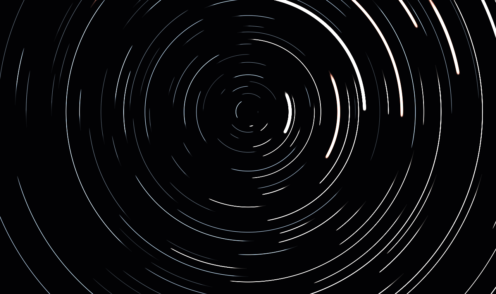
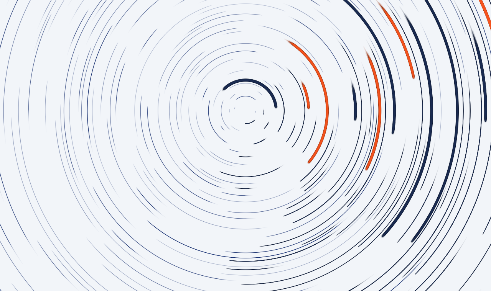
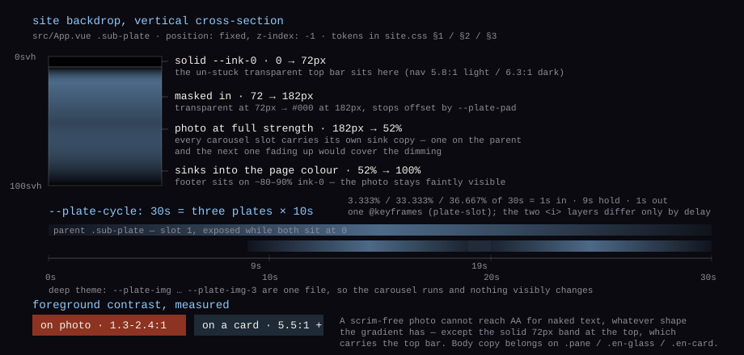
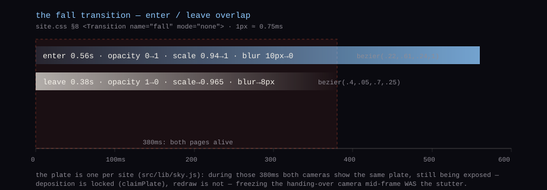

<div align="center">

# Escaping Notes

**STAR TRAILS · A Long-Exposure Notebook**

> Ink cast into the abyss, the stars startle and never return; light hoarded in these pages, the tide recedes yet the echo remains.

[](https://vuejs.org/)
[](https://vitejs.dev/)
[](https://router.vuejs.org/)
[](src/components/StarTrails.vue)
[](#license--usage-terms)
[](#license--usage-terms)
[](https://github.com/Escap1ng/Escaping-Notes/releases)

**[Live Demo](https://escaping.top)**

[中文](README.md) · **English**

</div>

---

## About

Escaping Notes is a personal blog and journal that treats writing as a long exposure of the night sky — the camera set up on the landing screen keeps the exposure for me: posts, updates, music, images and projects all land on the same plate. Three devices run that one camera —

- **Scroll as time** — within the landing screen, the further you go the longer the exposure window and the faster the sky turns (time flow 1 → 2.2×); it saturates after 1.1 viewport heights
- **Pointer as time dilation** — star trails within a 180px cursor radius locally accelerate and curl, fastest at the centre (up to 2.8×)
- **Meteors as narrative** — one falls every 6–9s, lives 900ms, at most 9 in frame; while the player is running the interval is squeezed toward its minimum and relaxes back on its own

Trails are only painted inside the landing screen. But **the deposition is site-wide**: the plate pixels and the clock are singletons in `src/lib/sky.js`, so changing routes never re-lays the plate — come back to the top and the same arcs are denser. Below the fold, photographs take over.

<table>
  <tr>
    <td width="50%"></td>
    <td width="50%"></td>
  </tr>
</table>

> Left dark / right light: both are **star-trail plates recomputed from the site's own constants** (`npm run art:build`), not screenshots — **they draw the trail layer only**; the live landing screen also carries a band of photo landscape along the bottom, star trails occluded along the ridge, and a title typed out character by character. They recompute exactly the steady-state plate that `prefers-reduced-motion` users are shown. They were lifted by a ×2.8 / ×1.6 developing gain, so **the site itself is darker**.

## Features

- **Dual themes** — dark (cold white / warm white / amber trails) and light (astronomical dry plate: slate/graphite trails + vermilion accents); trail colour temperature follows magnitude (dim stars cool, a few bright stars warm). **Switching theme no longer swaps the mountain** — the dark landing screen is a darkened bake of the same framing (`plate-hero-deep.jpg`) and both themes share one ridge polyline. Each theme deposits its own plate (to keep colours from bleeding); the default is light and the first frame deliberately ignores `prefers-color-scheme`, because the landing screen is a bright photograph
- **Landing typography** — the landscape strip is pinned to the bottom edge with its height derived from the photo itself (`.hero-plate` height = `clamp(54svh, 31vw, 70svh)`; 31vw is the photo's own cover height, so wide windows raise the fold and nothing gets cropped, while squarer windows keep the lower 54% and leave the upper half for type); trails are masked off along the ridge with `destination-in`, keeping ~60% of their brightness near the crest and feathering over 26px; the site name is typed out character by character (first keystroke after 260ms, 82ms per character, caret fades 1500ms after the last one) and only then does the sixteen-character manifesto release (0.9s reveal, second line 0.18s behind); the whole text block sinks at 0.25× scroll speed and fades out
- **Below the fold** — a drawer holding one local-time readout, three featured cards and the last five updates (the whole card links to `/updates`), pulled up from below the first time it enters the viewport; it rides on **one shared photographic plate for the whole site** — five slots on a carousel, 10s each (50s cycle), and on the dark theme all five tokens point to the same file so nothing changes at night. How blurred the plate is, is a runtime parameter: a 0–12px slider in the settings card, defaulted to full, remembered in `localStorage`; **card colour is a runtime parameter too**: two radios in the same card — opaque (**the default**: pure white on the light theme, an opaque ink face on the dark one, one setting with two surfaces to match it) or translucent (the photo shows through the card)
- **Unified design system** — every screen is assembled from one set of tokens and primitives: four scales (6 spacing / 11 type-size / 4 line-height / 3 weight steps), card tokens, buttons in "2 sizes × 4 semantics", inputs and filter chips sharing the card surface, three-state notices, single-character icons; no raw font sizes or spacings inside components (fluid display sizes use `clamp()`), so changing a scale updates the whole site
- **Canvas 2D rendering** — trails are drawn frame by frame with an offscreen accumulation buffer (280 stars, 140 on viewports ≤720px, and multiplied by 0.65 on the dark theme); no third-party UI kits, chart libraries or font CDNs — Vue and Vue Router are the only runtime dependencies, and the display faces are **two** self-hosted subset woff2 files (a serif for display text, a Didone for the masthead)
- **Accessibility** — focus traps in the header drawer, the player card, the settings card and both lightboxes (focus returns to the element that opened them), `Esc` or a click outside the reading plate returns from either detail page to its list, route changes announced to screen readers (`role="status"`), a focusable skip link and `#main`, ≥44px touch targets for buttons / links / chips under `pointer: coarse`, and a full static fallback under `prefers-reduced-motion` (title appears complete, trails are pre-computed as one 380-step plate, the carousel stops on its first slot)
- **Performance** — the landscape plate lives on `App.vue`, not in each page, so routing never repaints it; the landing photo (this page's LCP element) is `preload`ed by the inline first-paint script for the active theme, so it starts downloading alongside the stylesheet instead of after it; the `--shift` scroll depth caches its extreme instead of reading `scrollHeight` per frame (which is a reflow per frame); resize is debounced 150ms; the drawer's `IntersectionObserver` disconnects after one pull; card glows move by transform; the persistent header surface avoids `backdrop-filter` — glass is reserved for the surfaces that genuinely need isolating from the plate (reading panel, landing drawer, nav drawer, both lightboxes)
- **Reading legibility (stated plainly)** — a scrim-free landscape photo **cannot** reach WCAG AA for naked text: the worst measured point sits at 1.0–1.8:1 regardless of gradient shape (three shapes were tried — single vertical, double scrim top and bottom, fade-in from the top). So the work is divided: the plate is scenery, and body copy always lands on `.sheet` / `.en-glass` / `.en-card`, where the foreground starts at 5.5:1. `npm run check:contrast` recomputes the theme tokens against a flat ground before every commit (dark `--text-0` 18.38:1, light 16.90:1 against a 7:1 bar) — but that checks tokens against a solid colour, **not** the composited photo
- **Feedback loop** — skeleton cards while the archive loads (3 of them), distinct copy for "nothing here yet" vs "no search results", and tag/keyword filters written into the URL query (shareable, survives reload)
- **Gallery** — `/gallery` pins every image the site has used to one wall of Polaroids: 9 site-owned plates (two hero bands, five light plates, the dark scrim plate, `og.png`) plus every article cover, deduplicated by src; tilt is ±2.4° hashed from the src, entry staggers 60ms per card (capped at 12), columns run 3/2/1; the lightbox `Teleport`s to `body` with ←/→ paging, Esc to close and >50px swipes on touch
## Two load-bearing designs, in figures

### The plate layer hangs on `App.vue` — one `fixed` containing-block trap



Below the fold the landscape is one `position: fixed` `.sub-plate` layer living in `App.vue`, shared by the home drawer and every secondary page. It has to be there: `fall` puts a `filter` on the page root, and **a filter becomes the containing block for `position: fixed` descendants** — the same layer mounted inside `HomeView` measured as a `.home` box (587×1629, scrolling with the document), which is not a stationary backdrop at all. The other load-bearing half is that **each carousel slot carries its own sinking gradient** (`transparent 18% → var(--ink-0) 78%`): write it once on the parent and the slot that fades up covers the dimming, taking the text contrast with it. Blur is not baked into the source photo but is the runtime `--plate-blur`, which is why the layer extends 3× that in every direction — otherwise the blurred edge fades to transparent and shows a white ring around the viewport. The measurements behind all three decisions are recorded in the comments of `src/App.vue` and `src/lib/plate.js`.

### The `fall` afterimage — two pages on screen for 260ms



Now that the plate persists across routes, `fall` is the only transition left: the enter runs 0.44s (blur 15px→0, scale 0.88→1) and the leave 0.26s (0→12px, scale→0.9) in parallel — no `out-in` — and for the **260ms** they overlap both pages are on screen, both blurred; that overlap is the afterimage. During those 260ms it must be the same plate still being exposed, so `claimPlate()` in `src/lib/sky.js` **locks deposition only, never redraw**: the camera handing the plate over keeps drawing it every frame, otherwise it freezes mid-frame while fading out — exactly where the "stutter on switch" came from. With trails now mounted by a single camera there is never a moment when two coexist, so that mutex no longer contends; it stays as a guard rail.

## Tech Stack

| Layer | Choice |
| --- | --- |
| Frontend | Vue 3 (Composition API) + Vite 5 + Vue Router 4 |
| Rendering | Canvas 2D with an offscreen accumulation buffer (long-exposure plate simulation) |
| Styling | Plain CSS + custom-property tokens (one file, `site.css`: structural scales + the two theme palettes + site-wide primitives) |
| Testing | Node's built-in `node --test`, no test framework |
| Deployment | GitHub Pages / Vercel (read-only mirror) |

## Quick Start

Requirements: Node.js **22+** (`npm test` lets node expand the case list inside `tests/` itself, which needs 21 or newer; CI and the author's machine run 24).

```bash
# Clone and install
git clone https://github.com/Escap1ng/Escaping-Notes.git
cd Escaping-Notes
npm install

# Run the dev server
npm run dev

# Production build
npm run build          # post receipt + dist/ (rss.xml, sitemap.xml, one static shell per route)
npm run preview        # preview dist/ locally
```

### Scripts

| Command | Purpose |
| --- | --- |
| `npm run dev` | Vite dev server with HMR |
| `npm run build` | Production build (one routing mode only: history, `base` fixed at `/`). It first prints the **post receipt** and validates every roll — a red gate produces no `dist/`. Then `build_seo.mjs` emits `rss.xml`, `sitemap.xml` and the **per-page static shells**: every article roll, every project and every nav route gets its own `index.html` in `dist/` (with that page's title and cover in the head), plus one `404.html` |
| `npm run preview` | Serve `dist/` the way production would |
| `npm run test` | Everything under `tests/` (the count is `npm test`'s to report, not this table's): the content layer (frontmatter parsing, CRLF, every posting rule probed with its own fake sample, the real `content/posts/` run through the gate, and a sweep proving both shores share one parser), the release layer (per-page shell head rewriting and file placement, every URL advertised in the sitemap must have a file behind it, legacy `#/` links accepted or rejected, one routing mode only), markdown rendering and the URL injection surface, the three blur defaults never drifting apart, the card-surface setting never drifting apart (storage key / mode values / gate selector spelled identically in three places, the default being the base block's opaque value, and `--card-solid` defined for both themes with the light one exactly white), the first-paint theme, the preloaded landing photo matching `--hero-img` in `site.css`, the landing copy contract (the two fields the hero needs must exist in `narrative.js`, and no view may reference a field that isn't there — deleting one fails silently as empty text), pointer-feedback consistency (durations and offsets must come from the four tokens, or be listed as an explicit exception), token single source (no token defined twice, nothing defined for only one theme), the gallery list matching the asset manifest, the three project write-up fields being filled in and detail-page URLs round-tripping without collisions, and both detail pages sharing one return mechanism |
| `npm run seo:build` | Regenerate SEO artefacts only (`dist/rss.xml` — last 20 items, now with full text and categories; `dist/sitemap.xml`) |
| `npm run og:build` | Redraw the share card `public/og.png` (1200×630, procedural star trails drawn with Node built-ins, no text, committed) |
| `npm run art:build` | Redraw the two plates at the top of this page (constants are read out of the source by regex and it throws if they are gone, so re-run after touching star-trail parameters) |
| `npm run bg:build` | Re-bake the site backdrops in `public/plates/*.jpg` (hero band light + dark, the five-slot drawer carousel, the dark drawer scrim; originals live in `plates-src/`, needs local PowerShell; commit the output) |
| `npm run cover:build` | Re-bake article covers: walks `content/posts/<slug>/` and bakes each roll's own `*-src.jpg` into `cover.jpg` beside it (originals are neither committed nor published; there is no mapping table to edit; needs local PowerShell; commit the output) |
| `npm run font:build` | Re-subset the display font (needs Noto Serif SC locally; the output is committed, so this is rarely needed) |
| `npm run font:build:didone` | Re-subset the masthead Didone (Playfair Display, uppercase and space only, 3.6 KB out; the variable source TTF lives in `fonts-src/` and is not committed — fetch steps are written in the script header; the output is committed) |
| `npm run check` | Runs the four gates below in sequence (content / docs / naming / contrast) — the one command to run before committing |
| `npm run check:content` | The posting gate and receipt: reads every roll in `content/posts/` and fails on a malformed date, a misspelled frontmatter key, or an image referenced from prose that is not in that roll (also runs inside `npm run build` and in CI) |
| `npm run check:docs` | Checks that every file path and section reference in the docs still resolves, and that the README route table matches `src/router` |
| `npm run check:naming` | Naming-convention scan; non-zero exit on a violation |
| `npm run check:contrast` | Recomputes WCAG contrast from the two theme blocks in `site.css`; non-zero exit if a text token fails |

## Route Map

All 10 routes are lazy-loaded and each carries `meta.t` for the document title and the screen-reader announcement; the header nav shows the first 7 only.

| Route | Page | What it is |
| --- | --- | --- |
| `/` | Home · long-exposure star trails | Photo landscape band + trails + typed title + drawer |
| `/blog` | Articles | Archive, tag/keyword filters live in the URL |
| `/blog/:slug` | Article | A single post on a frosted-glass plate; its cover opens the lightbox |
| `/updates` | Activity | Short-log feed |
| `/records` | Music | Self-hosted track list + the player card |
| `/gallery` | Gallery | Wall of every image the site has used |
| `/projects` | Projects | Grid of project cards |
| `/projects/:slug` | Project write-up | One project on the same frosted-glass plate as an article; `Esc` or a click outside the plate returns to the list |
| `/about` | About | Bio · live counters · gear · friend links |

> The tenth route is the catch-all: anything unmatched renders the 404 page, titled 这里没有页面 ("there is no page here") — site copy is Chinese-only.

## Project Structure

```text
├── index.html             # Shell: inline first-paint script (theme + plate blur + card surface + preloading the landing photo for that theme, so none of them flashes), SEO/OG metadata
├── content/posts/         # Posts: one directory per post (`<slug>/index.md` plus that post's own cover and images) — the directory name is the URL
├── public/                # Static assets: favicon, robots.txt, og.png, plus two derived-asset dirs that **must be committed**
│                          #   plates/ (backdrops) · audio/ (self-hosted tracks) — see "Scripts" for the bake commands; article covers are not here, each lives in its own roll
│                          #   originals (plates-src/ · music/ · /1/ · each roll's *-src.*) are gitignored — do not report that as a leak
├── scripts/               # Build-time and content-refresh scripts (verb families)
│   ├── build_font.mjs     #   display-font subsetting (Node; needs the `subset-font` devDep)
│   ├── build_font_didone.mjs #  masthead Didone subsetting (same devDep; uppercase and space only)
│   ├── build_seo.mjs      #   rss.xml / sitemap.xml / og.png (Node built-ins only; frontmatter parsing comes from src/lib/schema.js — the same module the browser uses)
│   ├── build_readme_art.mjs # the two plates above: recomputed from StarTrails' constants
│   ├── build_plate_bg.ps1 / build_post_covers.ps1 # backdrop & cover baking (PowerShell + System.Drawing; cannot run on CI)
│   ├── check_content.mjs  #   the posting gate and receipt (walks every roll; runs inside the build and in CI)
│   ├── check_doc_refs.py  #   drift scan over doc references / § numbers / the README route table
│   ├── check_naming.py    #   naming-convention scan
│   ├── check_contrast.mjs #   theme-token WCAG contrast audit
│   ├── sync_records.py    #   fetch public QQ playlist → src/data/records.js (Python 3 stdlib; read-only mirrors)
│   ├── data/              #   script input data (the GB2312 level-1 character table used by build_font)
│   └── lib/               #   modules shared between scripts (PNG encoder; the roll scanner rolls.mjs)
├── docs/                  # design.md design spec · manual.md handbook
│   └── assets/readme/     # README figures (how they are made, and how to swap in real screenshots)
├── tests/                 # Zero-dependency safety net: node --test, run by `npm run test`
└── src/
    ├── assets/fonts/      # Two self-hosted subset woff2 files (serif + masthead Didone), weight 700 + OFL licence
    ├── components/        # seven flat: StarTrails the camera · HorizonHero the landing type layer · SiteHeader bar + drawer · SiteFooter · MusicCard the player card · SettingsCard the plate-blur slider + card-surface radios · SearchCard the header search card
    ├── data/              # everything site-owned lives here: index.js is the single door · narrative.js copy layer · site.js site info · 6 data files (records.js is generated — don't hand-edit)
    ├── lib/               # posts / schema / markdown / theme / storage / music / gallery / plate / surface / ridge / lens / shift / sky / debounce / focus / exit / legacy / projects (data access no longer passes through here — see data/index.js)
    ├── styles/            # site.css, one file: structural scale + the two theme palettes + site-wide primitives
    └── views/             # 10 views, one file each, flat
```

## Deployment

Full steps for both targets (GitHub Pages / Vercel read-only mirror) live in **[docs/manual.md §4](docs/manual.md#4-上传方法部署上线)** (Chinese). Key points:

- GitHub Pages is bound to the apex domain `escaping.top`; DNS records, verification commands and the certificate steps are in `docs/manual.md` §4.2
- Because the domain is bound at the root, `base` is fixed at `/` and the artefacts carry no repository prefix; there is a single routing mode (history)
- Pages never falls back to `index.html` for unknown paths, so the build writes a real file per route (`dist/blog/<slug>/index.html`, …) plus a `dist/404.html` — deep links answer 200 instead of 404, and the share card is the article's own cover
- Legacy `/#/blog/<slug>` links are rewritten to the path form before the app mounts (`src/main.js`), so links already posted elsewhere do not silently land on the home page

## Documentation

- [docs/design.md](docs/design.md) — the single source of truth for the interface design (concept, colour system, component contracts, developer guide; Chinese)
- [docs/manual.md](docs/manual.md) — handbook for editing, adapting and deploying (Chinese)
- [docs/assets/readme/README.md](docs/assets/readme/README.md) — where these four figures come from, how to re-run them, and what to do if you want real screenshots

## License & Usage Terms

Two things are licensed separately here: **blog content** is under CC BY-NC-SA 4.0, **source code and design** keep the original notice.

| Subject | Terms |
| --- | --- |
| **Blog content** — article text, original images and copy on this site | [CC BY-NC-SA 4.0](https://creativecommons.org/licenses/by-nc-sa/4.0/): you may copy, adapt and redistribute it, with attribution, for non-commercial purposes only, and derivatives must be published under the same licence |
| **Source code & design** — `src/`, `scripts/`, `docs/`, the visual and interaction design and the star-trail device | the non-commercial notice, i.e. the five items below |
| **Fonts** | the two display subsets are derived from Noto Serif SC and Playfair Display respectively (both SIL OFL 1.1); the full licence is at [src/assets/fonts/LICENSE-OFL.txt](src/assets/fonts/LICENSE-OFL.txt) |
| **Third-party material** | embedded playlists, blogroll links and off-site content keep their own terms and are not covered by this section |

The five items below govern only the "source code & design" row above:

1. **No commercial use** — Without prior written permission, no part of the source code or design may be used commercially or monetized in any way.
2. **Originality protection** — The core original designs (the "Long-Exposure Star Trails" metaphor, visual language and star-trail devices) may not be copied, imitated or republished under another name without permission.
3. **Citation** — Learning-purpose references must clearly credit the project and the author, and keep this notice.
4. **Disclaimer** — The project is provided "as is", without warranty of any kind; the author is not liable for any loss arising from its use.
5. **Licensing contact** — chunqi-yu@outlook.com.

© 2026 Escap1ng · Blog content under CC BY-NC-SA 4.0; source code and design all rights reserved
