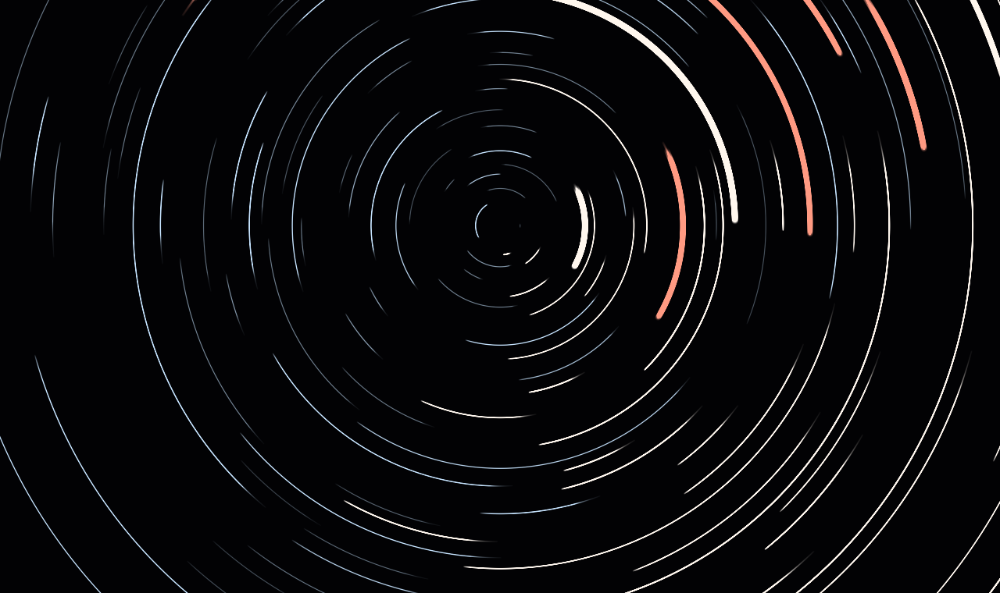
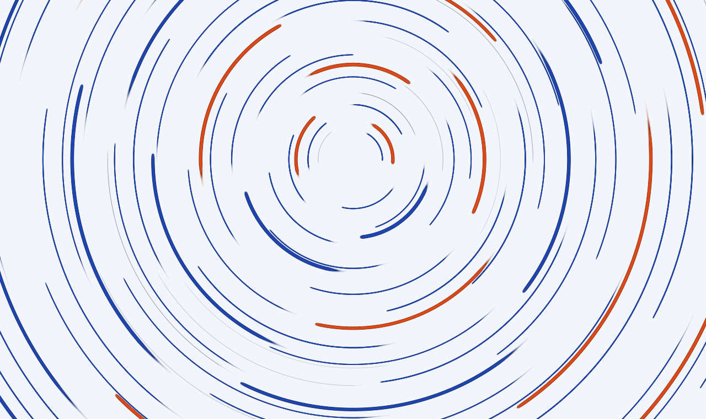

<div align="center">

# Escaping Notes

**把博客做成一次对夜空的长曝光**

首页是一台开着快门的相机。滚动让这一夜加速，文章按时间排，合集按主题分。

[**escaping.top**](https://escaping.top) · [English](README.en.md)

[](https://github.com/Escap1ng/Escaping-Notes/actions/workflows/deploy.yml)
[](https://github.com/Escap1ng/Escaping-Notes/releases)
[](https://vuejs.org/)
[](https://nodejs.org/)
[](#许可)

</div>


<sub>首图不是截图，是按站点同一套常数离线复算的稳态底片（`npm run art:build`，`ART_HERO=1` 取横幅景）——也就是 `prefers-reduced-motion` 访客看到的那一张。出图与页面共用同一对显示增益，图上的浓淡就是页面上的浓淡。</sub>

---

## 三条设定

| | |
| --- | --- |
| **滚动即时间** | 越往下滑，曝光窗口越长、天空转得越快（1 → 3.2 倍） |
| **指针即时间膨胀** | 光标 180px 内的星轨局部加速卷曲，进出有一秒惯性，不是硬边光斑 |
| **流星即叙事** | 每 6–9 秒落一颗；放歌时更密，停下自然回弹 |

底片与全站时钟是单例：换页不重铺，回到首页时弧接着上一次的曝光继续长。

## 星环

「像漩涡而不是星环」曾是三个可量化的缺陷，不是口味问题：

- **数列共振** — 星等用的 `0.381966…` 恰是角度序列的补数，两者相加恒为 1。亮星集中度 R=0.996，全挤在一个 45° 扇区。改为按星数配额分档 + 角度等分圆周。
- **半径与角度同步递增** — 相关系数 0.998，那是一条阿基米德螺线。角度槽位过一道互质步长排列后降到 0.205，均匀性不丢。
- **弧长各不相同** — 真实长曝光里所有恒星同时段走过相同角度。现在共享一个曝光窗口，层次交给星等：线宽、亮度、星核。

另有两条：笔画不细于 1.25px（亚像素是「细密淡线」的物理来源），星核画在当帧层不累积（累积了就又变成一道弧）。

<details>
<summary>结构剖面：底片层与转场时序</summary>


底片层必须挂在 `App.vue`：转场给页根加 `filter`，而 `filter` 会成为 `fixed` 后代的包含块——挂进 `HomeView` 量出来是跟着滚的 `.home` 盒子，不是静止背景。`fall` 进出并行，重叠的 380ms 里两页同时在台上、同时糊，那层糊就是重影。量出来的数在 [docs/design.md](docs/design.md)。

</details>

## 有什么

- **双主题同一座山** — 同一取景的亮版与压暗版共用一条山脊折线；切主题时旧底片淡出、新的分片显影，不清空整夜
- **一台播放器** — 绕极唱盘随播放转动，环形进度可拖可键盘，波形指纹由曲目派生，静音记状态
- **窄屏菜单** — 三根线形变成叉，每条导航带一句说明，当前页除颜色外另有竖线与圆点
- **键盘与指针同权** — 光带、星芒、扫光都有 `:focus-visible` 并列规则；焦点陷阱、`Esc` 退出、`/` 或 `⌘K` 开搜索
- **完整的静态降级** — `prefers-reduced-motion` 下星轨停在稳态底片，转场不糊，触控目标 44px
- **中文排版** — 中西文自动间距、标点悬挂、标题折行均衡；引用不用合成斜体

全站由一套令牌搭成，组件里不写裸字号与裸时长。两套自托管字体，无 CDN、无第三方 UI 库、无后端。

## 两个主题

<table>
  <tr>
    <td width="50%"></td>
    <td width="50%"></td>
  </tr>
</table>

<sub>左深右浅，同一台相机的两张稳态底片。深色加色合成、浅色墨压干版；首图是它们的横幅取景。</sub>

## 跑起来

需要 Node.js 22+。

```bash
npm install
npm run dev      # 开发服务器
npm run build    # 发文门禁 + dist/
npm run check    # 四道门禁：内容 / 文档 / 命名 / 对比度
npm test         # 154 项，零测试框架
```

构建即自检：日期写歪、键名拼错、正文引用了本卷没有的图，任一条红就不出产物。跑绿后产出 RSS、sitemap 与每条路由一份静态壳。多数测试带负向对照——同一把尺子量一份刻意改坏的样本必须变红。

<details>
<summary>其余脚本</summary>

| 命令 | 说明 |
| --- | --- |
| `npm run preview` | 本地按线上方式预览 `dist/` |
| `npm run art:build` | 重算底片双图；`ART_HERO=1` 出首图（常数从源码读，改星轨参数后重跑） |
| `npm run bg:build` | 重烘站点底图（需本机 PowerShell，产物需提交） |
| `npm run cover:build` | 逐卷把 `*-src.jpg` 烘成 `cover.jpg` |
| `npm run og:build` | 重绘分享卡 `public/og.png` |
| `npm run seo:build` | 只重跑 RSS 与 sitemap |
| `npm run font:build` · `font:build:didone` | 重切字体子集（产物已提交，日常不用跑） |

</details>

## 往里加东西

没有后台，改文件即可，push 即上线。

- **一篇文章 = 一个目录** — `content/posts/<slug>/index.md`，目录名就是网址。同目录放 `cover.jpg` 就是封面，列表、正文顶图、分享卡共用它；插图只写文件名，写错会在构建时被拦
- **frontmatter** — `collection` 必填；`draft: true` 只在本地可见；`movedFrom: [旧slug]` 让改名后的旧链接继续有效
- **项目** — `src/data/projects.js` 一处写全，按 star 降序排，URL 由名字现算
- **文案** — 全在 `src/data/narrative.js`，组件里不写字面量
- **外观** — 令牌在 `src/styles/site.css`

细节见 [docs/manual.md](docs/manual.md)。

## 页面地图

10 条路由全部懒加载；顶栏放 6 条，详情页与兜底不在栏上。

| 路由 | 页面 |
| --- | --- |
| `/` | 首页 · 长曝光星轨 |
| `/blog` | 文章归档 · 读数与标签筛选 |
| `/blog/:slug` | 正文 · 自动置顶封面与看片框 |
| `/collections` | 合集总览 |
| `/collections/:slug` | 合集目录 · 上级汇总后代 |
| `/updates` | 动态 · 手写条目与发文自动条目 |
| `/projects` | 项目卡片 |
| `/projects/:slug` | 项目介绍 |
| `/about` | 关于 |

未匹配的地址落到 404，标题与页内大字同一句。

## 部署

GitHub Pages 绑裸域名 `escaping.top`，push 后 CI 跑 `test → check → build`，全绿才发布。Pages 不回退未知路径，所以构建期为每条真实路由写一份静态壳——深链是 200，分享卡是那一篇自己的封面。Vercel 上是同一份产物的只读镜像。

完整步骤见 [docs/manual.md §4](docs/manual.md#4-上传方法部署上线)。

## 文档

[docs/design.md](docs/design.md) 是界面设计的唯一依据：概念、令牌、组件契约，以及被否掉的方案和量出来的数。
[docs/manual.md](docs/manual.md) 是使用手册。
[docs/assets/readme/README.md](docs/assets/readme/README.md) 说明配图从哪来、怎么重跑。

## 许可

**博客内容**（文章、原创图片与文案）依 [CC BY-NC-SA 4.0](https://creativecommons.org/licenses/by-nc-sa/4.0/)：署名、非商业、同协议分享。

**源代码与设计**（`src/`、`scripts/`、`docs/`、视觉与交互设计）依 [Apache-2.0](LICENSE)：可自由使用、修改、分发与商用，须保留版权与许可声明。商标不随许可授予。

字体取自 Noto Serif SC 与 Playfair Display，均 SIL OFL 1.1，条款见 [LICENSE-OFL.txt](src/assets/fonts/LICENSE-OFL.txt)。

本项目按「现状」提供，不附任何担保。授权联系 chunqi-yu@outlook.com。

<div align="center">
<sub>© 2026 Escap1ng</sub>
</div>
